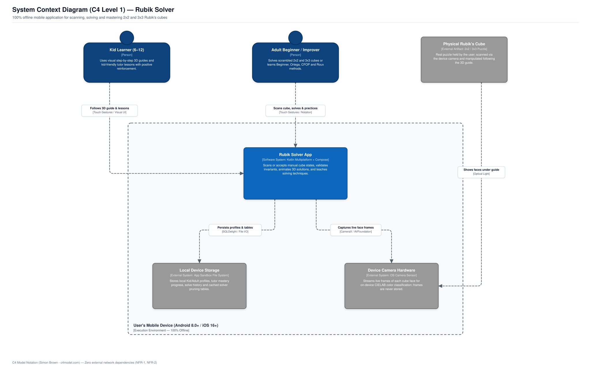
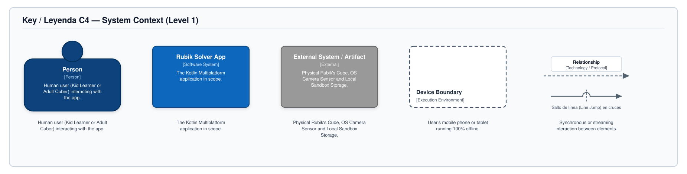
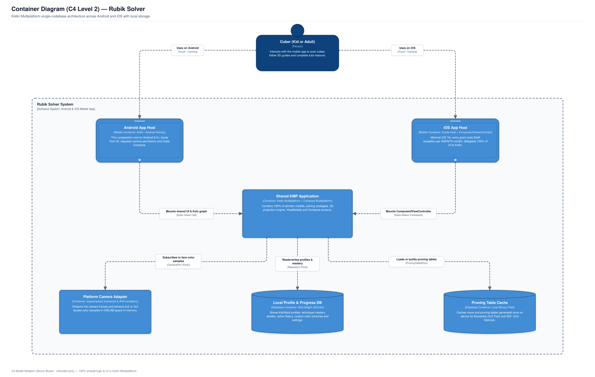
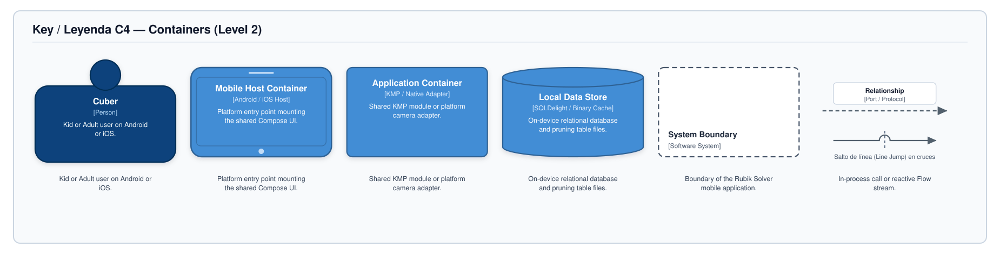
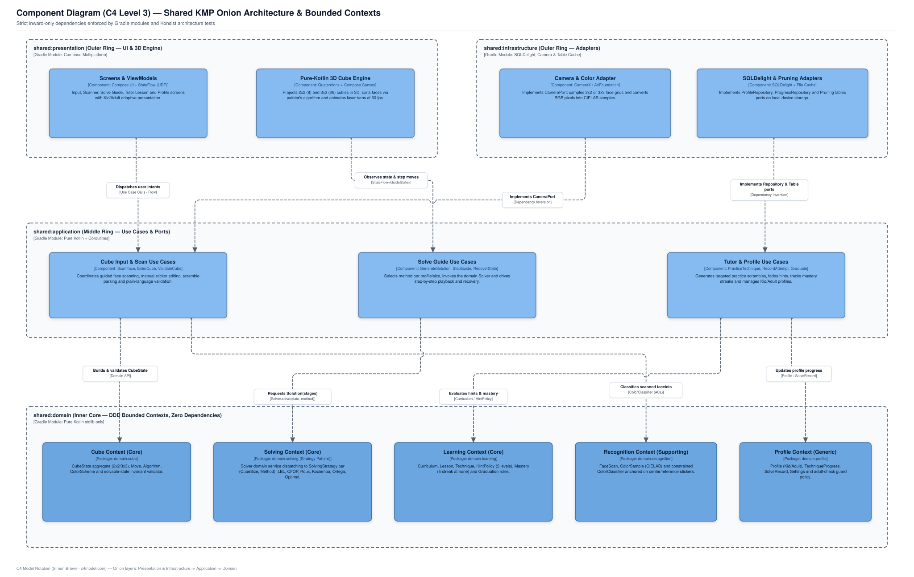
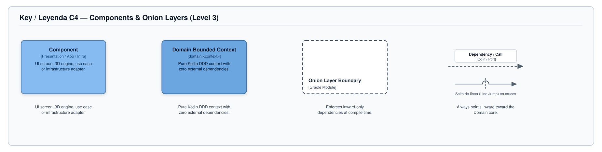

# Technical Specification — Rubik Solver

> **How** the product is built. Functional and quality requirements live in
> [functional-spec.md](functional-spec.md) and are referenced by ID (`FR-x.y`, `NFR-x`, `AC-x.y`), never restated.

## 1. Technology stack

| Concern | Choice | Fulfils |
|---|---|---|
| Language | Kotlin 2.1+ (100% of domain, application, adapters and UI) | NFR-6 |
| Multiplatform targets | `androidTarget` (API 26+), `iosArm64`, `iosSimulatorArm64` (iOS 16+), plus `jvm` on `:shared:*` for fast TDD/ATDD and Konsist verification | NFR-6 |
| Build & local toolchain | Gradle 8.11+ Kotlin DSL with Version Catalog (`gradle/libs.versions.toml`) and `asdf` (`.tool-versions` pinning OpenJDK 21 and Gradle) | — |
| UI & 3D rendering | Compose Multiplatform + custom pure-Kotlin 3D engine on `Canvas` | FR-3, FR-4, NFR-3 |
| Concurrency & state | `kotlinx.coroutines` + `StateFlow` / `SharedFlow` (unidirectional data flow) | NFR-3 |
| Dependency injection | Koin Multiplatform (wired exclusively in the composition root) | — |
| Local persistence | SQLDelight (SQLite on Android & iOS) + binary file cache for pruning tables | FR-6, NFR-1, NFR-2 |
| Localization | Compose Multiplatform Resources (`values/`, `values-es/`) | FR-7.1, NFR-7 |
| Camera adapters | `expect`/`actual` adapters: CameraX (`ImageAnalysis`) on Android, `AVCaptureSession` on iOS | FR-1.2, NFR-2 |
| Acceptance & unit tests | Kotest (`BehaviorSpec` for `AC-x.y`, `FunSpec` + property testing for domain) | NFR-4 |
| Architecture enforcement | Konsist in `commonTest` / `jvmTest` | — |
| Static analysis & coverage | ktlint, detekt, Kover | — |
| CI/CD | GitHub Actions + release-please (Conventional Commits) | — |

**Sole non-Kotlin file (`AGENTS.md` §4):** `iosApp/iosApp/iOSApp.swift`, the minimal Xcode entry point that mounts
`MainViewController()` from `shared:presentation`.

## 2. Architecture overview (C4 Model & Onion Architecture)

### 2.1 Level 1 — System Context

The app runs 100% on the user's device with zero network calls (`NFR-1`, `NFR-2`).





### 2.2 Level 2 — Containers

Android and iOS hosts are thin shells around the shared Kotlin Multiplatform codebase.





### 2.3 Level 3 — Components & Onion Layers

Dependencies point strictly inward: `presentation` & `infrastructure` → `application` → `domain`.





### 2.4 Gradle module layout

```text
rubik-solver/
├── shared/
│   ├── domain/           # Pure Kotlin (stdlib only). Zero framework/platform dependencies.
│   ├── application/      # Use cases and inbound/outbound ports. Depends only on :shared:domain.
│   ├── infrastructure/   # SQLDelight, pruning-table cache, expect/actual camera adapters. Depends on :shared:application, :shared:domain.
│   └── presentation/     # Compose Multiplatform screens, 3D Canvas renderer, ViewModels. Depends on :shared:application, :shared:domain.
├── androidApp/           # Android Activity + Koin bootstrap. Depends on all :shared:* modules.
└── iosApp/               # Minimal Xcode project hosting MainViewController().
```

Compile-time module boundaries prevent outer-layer imports in inner layers; Konsist tests additionally verify package
and naming rules across all source sets.

## 3. Domain-Driven Design (Bounded Contexts)

All domain models live in `:shared:domain` under `com.rubiksolver.domain.<context>`, are immutable value objects or
aggregates, and use the ubiquitous language defined in `functional-spec.md` §4.

| Bounded Context | Kind | Core Types | Fulfils |
|---|---|---|---|
| **Cube** (`domain.cube`) | Core | `CubeState` (aggregate), `CubeSize` (`TWO`, `THREE`), `Face`, `Sticker`, `Piece`, `ColorScheme`, `Move`, `Algorithm`, `Scramble`, `CubeValidator`, `ValidationError` | FR-1.1, FR-1.4–FR-1.6, FR-2.1–FR-2.6 |
| **Solving** (`domain.solving`) | Core | `Solver` (domain service), `SolvingStrategy`, `Method`, `Solution`, `Stage`, `Step`, `PruningTables` (domain port) | FR-3.1–FR-3.7, NFR-3, NFR-4 |
| **Learning** (`domain.learning`) | Core | `Curriculum`, `Lesson`, `LessonPhase`, `Technique`, `HintLevel`, `HintPolicy`, `PracticeScrambleGenerator`, `MasteryProgress`, `GraduationPolicy` | FR-5.1–FR-5.9 |
| **Recognition** (`domain.recognition`) | Supporting | `LabColor`, `FaceSampleGrid`, `FaceScan`, `ScanOrientationGuide`, `ConstrainedColorClassifier` | FR-1.2, FR-1.3 |
| **Profile** (`domain.profile`) | Generic | `Profile` (`Id`, `Name`, `Avatar`, `ProfileKind.KID` / `ADULT`), `SolveRecord`, `Settings`, `AdultCheckChallenge` | FR-6.1–FR-6.4, FR-7.1–FR-7.4, NFR-8 |

### Context relationships

- **Cube** is a **Shared Kernel** used by **Solving** and **Learning** (`CubeState`, `Move`, `Algorithm`).
- **Recognition → Cube** uses an **Anti-Corruption Layer** (`ConstrainedColorClassifier` translates noisy `LabColor`
  samples from 6 `FaceScan`s into a candidate `CubeState` before passing it to `CubeValidator`).
- **Learning → Solving** invokes `Solver` and stage detectors to generate targeted practice states (`FR-5.3`) and to
  evaluate step-by-step hints (`FR-5.4`).

## 4. Cube representation & invariant validation (`FR-2`)

`CubeState` supports both `CubeSize.TWO` (24 stickers / 8 corners) and `CubeSize.THREE` (54 stickers / 6 centers, 12
edges, 8 corners) and exposes both sticker-level and piece-orientation/permutation coordinates.

`CubeValidator.validate(state, scheme)` runs deterministic checks in order and returns all violations with offending
sticker coordinates so the UI can highlight them (`FR-2.5`):

1. **Sticker count** (`FR-2.1`, `AC-2.1`): exactly $N^2$ stickers of each of the 6 scheme colors.
2. **Center topology** (`FR-2.2`, `AC-2.2`, 3x3 only): the 6 center stickers are distinct and opposite pairs match
   `ColorScheme`.
3. **Piece bijection** (`FR-2.3`, `AC-2.3`): every corner (and edge on 3x3) color tuple corresponds to a legal piece
   in `ColorScheme` and appears exactly once.
4. **Group theory solvability** (`FR-2.4`, `AC-2.4`):
   - Corner orientation sum: $\sum co_i \equiv 0 \pmod 3$.
   - Edge orientation sum (3x3): $\sum eo_i \equiv 0 \pmod 2$.
   - Permutation parity (3x3): $\text{sgn}(\pi_{\text{corners}}) = \text{sgn}(\pi_{\text{edges}})$.
5. **Solved check** (`FR-2.6`, `AC-2.6`): all faces monochromatic.

## 5. Solving engine — Strategy pattern (`FR-3`, `NFR-3`, `NFR-4`)

`Solver` is a pure domain service that delegates to a `SolvingStrategy` keyed by `(CubeSize, Method)`:

```kotlin
package com.rubiksolver.domain.solving

interface SolvingStrategy {
    val size: CubeSize
    val method: Method
    fun solve(state: CubeState): Solution
}

class Solver(strategies: Set<SolvingStrategy>) {
    private val registry: Map<Pair<CubeSize, Method>, SolvingStrategy> =
        strategies.associateBy { it.size to it.method }

    fun availableMethods(size: CubeSize): Set<Method> =
        registry.keys.filter { it.first == size }.mapTo(linkedSetOf()) { it.second }

    fun solve(state: CubeState, method: Method): Solution {
        val strategy = registry[state.size to method]
            ?: throw UnsupportedMethodException(state.size, method)
        return strategy.solve(state)
    }
}
```

### Strategy catalog

| Strategy class | `CubeSize` | `Method` | Approach & stages | Target bound |
|---|---|---|---|---|
| `Beginner3x3Strategy` | `THREE` | `BEGINNER` | Rule- & table-driven layer-by-layer: White Cross → White Corners → Middle Edges → Yellow Cross → Yellow Edges → Yellow Corners Position → Yellow Corners Orient | ≤ 110 moves |
| `Cfop3x3Strategy` | `THREE` | `CFOP` | Cross (IDA* depth ≤ 8) → F2L (4 slot pair tables) → OLL (57 algorithms, 2-look option in Tutor) → PLL (21 algorithms) | ≤ 65 moves |
| `Roux3x3Strategy` | `THREE` | `ROUX` | First Block (1x2x3 search) → Second Block → CMLL (42 algorithms) → LSE (EO → UL/UR → EP) | ≤ 55 moves |
| `Kociemba3x3Strategy` | `THREE` | `FAST` | Two-phase coordinate search ($G_0 \to G_1 = \langle U,D,R^2,L^2,F^2,B^2 \rangle \to \{I\}$) using `PruningTables` port | ≤ 25 moves (`NFR-4`) |
| `Beginner2x2Strategy` | `TWO` | `BEGINNER` | First Layer Corners → Orient Last Layer → Permute Last Layer | ≤ 35 moves |
| `Ortega2x2Strategy` | `TWO` | `ORTEGA` | First Face (any permutation) → OLL (7 cases) → PBL (5 cases) | ≤ 20 moves |
| `Optimal2x2Strategy` | `TWO` | `OPTIMAL` | Exact IDA* over corner permutation ($8! = 40\,320$) and orientation ($3^7 = 2\,187$) pruning tables | ≤ 11 moves HTM (`NFR-4`) |

- **Open/Closed:** Adding a new method or cube size requires only implementing `SolvingStrategy` and registering it in
  Koin; `Solver` and the application layer remain untouched.
- **Explanation generation (`FR-3.2`):** Human-method strategies attach a semantic `ExplanationKey` and highlighted
  piece coordinates to every `Step`; `presentation` resolves `ExplanationKey` into localized adult or kid text
  (`FR-5.7`, `NFR-7`). `Kociemba3x3Strategy` and `Optimal2x2Strategy` emit steps with `ExplanationKey.MOVE_ONLY`.
- **Pruning tables (`NFR-3`):** `PruningTables` is a domain port implemented in `infrastructure` by a binary file
  cache (~3.5 MB for Kociemba + 2x2 tables). On first use of `FAST`, if the cache file is absent, tables are generated
  in a background dispatcher (~5–15 s) with progress reporting.

## 6. Pure-Kotlin 3D rendering engine (`FR-4`, `NFR-3`)

Located in `:shared:presentation` (`ui.cube3d`), implemented 100% in `commonMain` on top of Compose `Canvas`:

1. **Scene model:** 8 (`2x2`) or 26 (`3x3`) unit cubies in model space, each holding up to 3 outward sticker quads with
   rounded bevel polygons and optional color-blind symbol paths (`FR-7.3`).
2. **Rotations:** Camera orbit (`FR-4.2`) and active layer turn (`FR-4.3`) are represented as unit quaternions. During
   a move animation of angle $\theta(t) \in [0, \pm \pi/2, \pi]$ (interpolated with cubic ease-in-out), only cubies in
   the turning slice receive the slice quaternion before camera projection.
3. **Projection & visibility:** Perspective projection to 2D canvas coordinates, back-face culling via surface normal
   dot product ($\mathbf{n} \cdot \mathbf{v} < 0$), and **painter's algorithm** sorting visible quads by view-space
   centroid $z$ (at most $26 \times 6 = 156$ quads per frame — < 1 ms on CPU, sustaining 60 fps).
4. **Direction arrow & gesture picking (`FR-4.3`, `FR-4.4`):** 3D curved arrow segments are projected in the active
   slice plane; touch drags ray-cast onto the nearest front-facing sticker quad and project the drag vector onto the
   two candidate slice axes in free-play mode.

## 7. Camera scanning & color classification (`FR-1.2`, `FR-1.3`, `NFR-2`)

1. **Platform capture (`infrastructure.camera`):** `CameraPort` streams downsampled preview frames and the 9 (or 4)
   grid ROI average RGB values in memory; raw frames are discarded immediately after sampling (`NFR-2`).
2. **Color space:** RGB samples are converted to **CIELAB** ($L^*a^*b^*$) and compared using $\Delta E_{2000}$ so
   classification is resilient to shadows and warm/cool lighting (`L*` channel weighted lower than `a*, b*`).
3. **Constrained classification (`domain.recognition`):**
   - On `3x3`, the 6 center samples act as color anchors for the 6 faces.
   - The remaining 48 (or 24 on `2x2`) samples are assigned to the 6 colors via minimum-cost assignment subject to
     exact cardinality ($N^2$ stickers per color), guaranteeing `FR-2.1` out of the classifier while still allowing
     manual correction (`FR-1.3`).

## 8. Tutor curriculum & adaptive hints (`FR-5`)

- **Targeted scramble generation (`FR-5.3`, `AC-5.3`):** Each `Technique` defines its stage invariant (which pieces
  must already be solved) and its target case. `PracticeScrambleGenerator` applies the inverse of a random case
  algorithm conjugated by random setup moves within the invariant subgroup, then runs `Kociemba3x3Strategy` /
  `Optimal2x2Strategy` to produce a short scramble that lands directly on that lesson's case.
- **Hint state machine (`FR-5.4`, `FR-5.5`, `AC-5.4`, `AC-5.5`):**
  - `HintLevel`: `FULL_ANIMATION` → `NEXT_MOVE` → `NOTATION_ONLY` → `STAGE_NAME` → `NONE`.
  - 3 consecutive successes at a level promote the user to the next level; `Mastery` is recorded after 5 consecutive
    successes at `NONE`.

## 9. Testing & verification strategy (`AGENTS.md` §2)

| Layer | Suite | Location | Rules |
|---|---|---|---|
| Acceptance (ATDD) | Kotest `BehaviorSpec` | `:shared:application/src/commonTest` | Every `AC-x.y` in `functional-spec.md` has a matching test containing `"AC-x.y"` in its `Scenario` name. |
| Domain unit & property (TDD) | Kotest `FunSpec` + `checkAll` | `:shared:domain/src/commonTest` | 100% line coverage target. Shared `SolvingStrategyContractSpec` runs on all 7 strategies: *applying `solve(state)` to any scrambled state produces a solved cube within the strategy's move bound (`AC-3.2.2`, `NFR-4`)*. |
| Architecture | Konsist | `:shared:domain/src/jvmTest` | Asserts zero imports outside `kotlin.*` in `domain`, inward-only layer dependencies, immutable domain properties (`val`), and strategy naming conventions. |
| Presentation / UI | Compose Multiplatform UI Test | `:shared:presentation/src/commonTest` | Verifies UDF state transitions and accessibility semantics (`NFR-5`). |

## 10. CI/CD pipeline (`.github/workflows/`)

- **`docs.yml`** (active in Phase 1): lints Markdown (`markdownlint-cli2`) and blocks PRs to `main` if any file other
  than `.gitkeep` remains in `docs/specs/wip/` (`AGENTS.md` §1).
- **`pr-title.yml`** (active in Phase 1): enforces Conventional Commit PR titles (`AGENTS.md` §5).
- **`ci.yml`** (added in Phase 2): runs on every PR and push to `main`:
  1. Spec-to-test traceability check (`AC-x.y` in `functional-spec.md` ↔ Kotest `BehaviorSpec`).
  2. `ktlintCheck` + `detekt`.
  3. Konsist architecture tests.
  4. `allTests` on JVM/Android (`ubuntu-latest`) and iOS Simulator (`macos-latest`) + Kover coverage gate (≥ 95% on
     `:shared:domain`).
- **`release.yml`** (added in Phase 2): `release-please` maintains semantic versioning and changelogs from
  Conventional Commits on `main`.

## 11. Architectural Decisions (ADR Table)

| ID | Decision | Alternatives considered | Rationale |
|---|---|---|---|
| ADR-01 | **Gradle modules per Onion layer, packages per Bounded Context** | Modules per Bounded Context × Layer (20+ modules); single monolithic `shared` module | 4 shared modules enforce the Onion dependency rule at compile time while keeping build configuration fast and simple. |
| ADR-02 | **Pure-Kotlin 3D projection engine on Compose `Canvas`** | Native OpenGL/Metal via `expect`/`actual` (Filament / SceneKit) | A 3x3 cube has at most 156 quads; CPU projection + painter's algorithm easily runs at 60 fps (`NFR-3`), keeps 100% of rendering code in `commonMain`, and eliminates native scene-graph complexity. |
| ADR-03 | **`Solver` domain service with `SolvingStrategy` per `(CubeSize, Method)`** | Single procedural solver with `when (method)` branches; one port per method | Isolates each solving algorithm (rule-based human methods vs coordinate-search optimal solvers), satisfies Open/Closed, and lets all 7 strategies share a single property-based contract test suite. |
| ADR-04 | **SQLDelight for local persistence + binary files for pruning tables** | Room KMP; multiplatform-settings | SQLDelight offers mature KMP support and compile-time verified SQL for relational profile/progress queries (`FR-6`), while raw binary files load ~3.5 MB pruning tables in milliseconds without SQLite overhead (`NFR-3`). |
| ADR-05 | **CIELAB ($\Delta E_{2000}$) + cardinality-constrained assignment for camera scan** | Raw RGB/HSV thresholds; on-device ML model (TFLite/CoreML) | Anchoring on center stickers in CIELAB with exact sticker-count assignment is deterministic, requires zero ML weights, works under uneven lighting, and runs in < 2 ms per frame (`FR-1.2`, `NFR-3`). |
| ADR-06 | **Kotest `BehaviorSpec` in `commonTest` for ATDD** | Cucumber-JVM | Runs across all KMP targets (not JVM-only) and maps Gherkin `Given`/`When`/`Then` blocks directly to `AC-x.y` IDs (`AGENTS.md` §2). |
