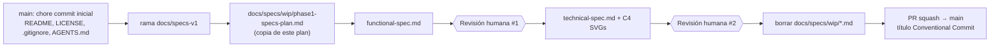
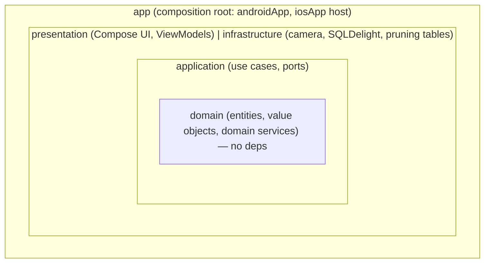

# Fase 1 — Bootstrap del repo `rubik-solver` + Especificaciones funcional y técnica

## Objetivo

Crear el repositorio público `FranciscoJGaviria/rubik-solver` y dejar la **base documental** para que humanos y agentes construyan la app:

1. Repo git + GitHub, con `README.md`, `LICENSE`, `.gitignore` (KMP) y **`AGENTS.md`**, que tiene las reglas de arquitectura y de proceso.
2. **Spec funcional** (`docs/specs/functional-spec.md`): describe **qué** hace el producto, sin decir cómo.
3. **Spec técnica** (`docs/specs/technical-spec.md`): describe **cómo** se construye: Kotlin Multiplatform al 100 %, Onion Architecture, DDD, TDD/ATDD y CI/CD.
4. Diagramas C4 (`.svg`) en `docs/architecture/images/`.
5. Un CI mínimo para documentación y Conventional Commits.

En esta fase **no se escribe código de la app**.

### Decisiones tomadas (según tus respuestas)

| Tema | Decisión |
|---|---|
| "Principio elegante" | Specs cortas y sin redundancia. Cada requisito aparece **una sola vez**, con un ID trazable (`FR-xxx`, `NFR-xxx`, `AC-xxx`). |
| Repo | Público: `FranciscoJGaviria/rubik-solver` |
| Plataformas | Android + iOS |
| 3D | Motor 3D propio en Kotlin común (proyección + Compose Canvas), sin dependencias nativas de render |
| Escaneo | Cámara en vivo, una cara a la vez con guía, detección de color en el dispositivo y corrección manual de stickers |
| Métodos | LBL (principiante), CFOP, Roux y Kociemba (modo "rápido") |
| Idioma | App bilingüe ES/EN; docs y código en inglés |
| Datos | 100 % offline, sin backend, perfiles locales (niño/adulto), progreso guardado localmente |
| Cubos | 2x2 y 3x3 desde el inicio |
| ATDD | Escenarios Gherkin en la spec funcional, ejecutados con Kotest en `commonTest` |

---

## User Review Required

> [!NOTE]
> ✅ **Aprobado:** se permite el host mínimo de iOS en Swift como única excepción.
>
> **Kotlin al 100 % frente al host de iOS.** Una app iOS hecha con Compose Multiplatform necesita un proyecto Xcode como host. Ese host normalmente lleva unas 10 líneas de Swift (`iOSApp.swift`, que llama a `MainViewController()`). Propongo dejar en `AGENTS.md` esta regla: *"100 % de la lógica y la UI en Kotlin; la única excepción permitida es el punto de entrada mínimo de iOS"*. La alternativa sería un `main()` en Kotlin/Native con `UIApplicationMain`. Es posible, pero se aleja del template oficial y complica el tooling.

> [!IMPORTANT]
> **Métodos para el 2x2.** CFOP y Roux son métodos de 3x3. Para el 2x2 propongo: **Principiante (LBL adaptado)**, **Ortega** (tutor intermedio) y **Óptimo** (búsqueda en el dispositivo, máximo 11 movimientos). ✅ Aprobado.

> [!WARNING]
> **Auth de GitHub.** `gh auth status` dice que el token de `FranciscoJGaviria` no es válido. Antes de crear el remoto quizá tengas que correr `gh auth login -h github.com`. El repo local se puede crear de todas formas.

## Resolved Questions

1. **Licencia:** Apache-2.0.
2. **Archivos para agentes:** solo `AGENTS.md`. No se crean `GEMINI.md` ni `CLAUDE.md`.
3. **Edad mínima:** 6 años. Hay un perfil "Kid" y otro "Adult".
4. **Versiones mínimas:** Android API 26 (8.0) e iOS 16.
5. **Métodos para 2x2:** Beginner, Ortega y Optimal (los tres).

---

## Flujo de trabajo de esta fase (trunk-based + plan temporal)



- El commit inicial va directo a `main`: es el bootstrap y todavía no hay nada que proteger.
- Todo lo demás va en una rama corta `docs/specs-v1`. El plan vive en `docs/specs/wip/` **solo dentro de esa rama** y se borra antes de hacer merge, como dice la regla que pediste.
- Después del merge, sugiero proteger `main` (PR obligatorio + checks). Lo dejo documentado; si quieres que lo active con `gh`, me lo indicas.

---

## Proposed Changes

### 1. Raíz del repositorio

#### [NEW] `README.md`
Pitch del producto en un párrafo, estado ("Phase 1: specifications"), enlaces a `AGENTS.md` y `docs/`. Sin repetir el contenido de las specs.

#### [NEW] `LICENSE`
Apache-2.0.

#### [NEW] `.gitignore`
Estándar para KMP: Gradle, `build/`, `.idea/`, `local.properties`, `*.iml`, `.kotlin/`, Xcode (`xcuserdata/`, `DerivedData/`), `.DS_Store`.

#### [NEW] `AGENTS.md`
Fuente única de reglas para cualquier agente o persona. Borrador:

```markdown
# AGENTS.md — Rules every agent MUST follow

## 0. Source of truth
- Functional spec (WHAT): docs/specs/functional-spec.md
- Technical spec (HOW):   docs/specs/technical-spec.md
- If code and spec disagree, the spec wins; change the spec first (in the same PR) if needed.
- Keep specs elegant: one requirement, one place, one ID. No duplication between specs.

## 1. Plan first
- Never implement a feature without a plan.
- Plans live in docs/specs/wip/<feature>.md, are committed ONLY on the feature branch,
  and MUST be deleted before the branch is merged.
- A plan references the requirement IDs (FR-/NFR-/AC-) it fulfils.

## 2. Test-driven, acceptance-first (ATDD + TDD)
- Start every feature from its acceptance criteria (Gherkin AC-xxx in the functional spec).
- Write the failing acceptance test first (Kotest BehaviorSpec, named with the AC ID).
- Then inner TDD loop: red → green → refactor. No production code without a failing test.
- Domain layer: aim for 100% coverage; property-based tests for cube invariants.

## 3. Architecture: Onion + DDD
- Layers (inner → outer): domain → application → infrastructure / presentation → app.
- Dependencies point inward only. Domain has ZERO dependencies (no Compose, no coroutines
  frameworks beyond stdlib, no platform APIs).
- Bounded contexts: Cube, Solving, Recognition, Learning, Profile (see technical spec).
- Use ubiquitous language from the functional spec glossary in code names.
- Ports (interfaces) live in application/domain; adapters live in infrastructure.
- Architecture rules are enforced by Konsist tests; never disable them.

## 4. Language & platform
- Kotlin only, Kotlin Multiplatform for 100% of logic and UI (Compose Multiplatform).
- Platform code only via expect/actual or adapters in infrastructure.
- Sole exception: the minimal iOS host entry point required by Xcode.

## 5. Git & delivery
- Trunk-based development: main is always releasable; short-lived branches (≤ 2 days).
- Branch names: <type>/<short-desc> (feat/, fix/, docs/, chore/, refactor/, test/, ci/).
- Conventional Commits for every commit and PR title; squash-merge to main.
- Incomplete features ship behind feature flags, never on long-lived branches.
- CI/CD with GitHub Actions; a red pipeline blocks merge.

## 6. Definition of Done
- Acceptance tests for the referenced AC IDs pass; unit tests pass; Konsist passes;
  lint (ktlint/detekt) passes; specs updated if behaviour changed; wip plan deleted.
```

<!-- GEMINI.md / CLAUDE.md: descartado, solo AGENTS.md -->

---

### 2. Documentación — índice

#### [NEW] `docs/README.md`
Índice de la documentación y **roadmap de fases**. Cada fase futura tendrá su propio plan en `wip/`:

| Fase | Contenido |
|---|---|
| 1 | Specs + AGENTS.md (esta) |
| 2 | Esqueleto KMP + módulos onion + CI completo + Konsist |
| 3 | Dominio Cube (2x2/3x3, moves, validación) |
| 4 | Motor 3D + visor interactivo |
| 5 | Ingreso manual + solvers (LBL, Kociemba) |
| 6 | Guía animada paso a paso |
| 7 | Escaneo con cámara |
| 8 | Modo tutor (currículo, maestría) + CFOP/Roux |

#### [NEW] `docs/specs/wip/.gitkeep`
Para que la carpeta exista en `main`.

---

### 3. Spec funcional — el QUÉ

#### [NEW] `docs/specs/functional-spec.md`
Va en inglés y **no menciona** tecnologías, frameworks ni arquitectura. Estructura:

1. **Vision & goals.** Que cualquier persona (desde los 6 años) resuelva un cubo con la app y, en algún momento, **sin la app**.
2. **Personas.** Kid learner, adult beginner, intermediate speedcuber-to-be, "just solve it" user.
3. **Ubiquitous language (glossary).** Cube, Size (2x2/3x3), Face, Facelet/Sticker, Cubie, Move, Notation (Singmaster), Algorithm, Scramble, Cube State, Solution, Step, Stage (p. ej. "White Cross"), Method, Technique, Lesson, Mastery, Profile. *Este glosario es la base del DDD.*
4. **Capabilities and functional requirements.** Cada uno con su ID y criterios de aceptación en Gherkin:

| Área | Requisitos (resumen) |
|---|---|
| FR-1 Cube Input | Elegir el tamaño. Escanear con la cámara, cara por cara, con guía de orientación. Corregir cualquier sticker. Ingreso manual tocando los stickers. Ingresar un scramble en notación. |
| FR-2 Validation | Detectar estados imposibles (conteo de colores, centros, paridad, orientación) y explicar el error en lenguaje simple. |
| FR-3 Solve Guide | Elegir método (LBL, CFOP, Roux, Rápido; para 2x2: Beginner, Ortega, Optimal). Ver la solución dividida en etapas y pasos. Play/pause/siguiente/anterior/velocidad. Mostrar la notación y una explicación en palabras de cada paso. |
| FR-4 3D Viewer | Cubo en 3D que se puede rotar con gestos. El giro de cada capa se anima. Se puede ver desde cualquier ángulo durante la guía. |
| FR-5 Tutor | Currículo por método y nivel. Lecciones cortas (concepto → demostración → práctica guiada → práctica libre). Evaluación de maestría por etapa. Pistas cada vez menores hasta resolver sin ayuda ("graduation"). Adaptado por perfil (Kid/Adult). |
| FR-6 Profiles & Progress | Perfiles locales, progreso por técnica, historial de resoluciones y tiempos. |
| FR-7 Settings | Idioma ES/EN, esquema de colores, velocidad de animación, mano dominante. |

5. **Non-functional requirements (qué, no cómo).** NFR: offline total. Rendimiento percibido (p. ej. solución en ≤ 2 s, animación fluida). Accesibilidad (daltonismo: stickers con símbolo opcional, tamaños táctiles). Privacidad (ningún dato sale del dispositivo, nada de cuentas, apto para niños). Bilingüe.
6. **Out of scope (v1).** Cubos NxN mayores a 3x3, backend o sincronización, modo competitivo online, smart cubes Bluetooth.

Ejemplo de criterio de aceptación:

```gherkin
# AC-2.1 — Impossible color count
Scenario: User enters a 3x3 with ten white stickers
  Given a 3x3 cube state with 10 white facelets
  When the user confirms the cube
  Then the cube is rejected
  And the user is told which color has too many stickers
```

**→ Revisión humana #1** al terminar esta spec.

---

### 4. Spec técnica — el CÓMO

#### [NEW] `docs/specs/technical-spec.md`
Se refiere a la spec funcional por ID y no repite los requisitos. Estructura:

1. **Stack.** Kotlin, KMP (targets `androidTarget`, `iosArm64`, `iosSimulatorArm64`), Compose Multiplatform, Coroutines/Flow, Koin (DI), SQLDelight (persistencia), Compose Resources (i18n ES/EN), androidx Lifecycle ViewModel + Navigation (KMP), Kotest (+ property testing), Konsist, ktlint + detekt, Kover.
2. **Onion architecture.**



   - La regla de dependencias se cumple con **módulos Gradle** (una capa no puede importar algo que no está en sus dependencias) y además con **tests Konsist**.
3. **DDD: bounded contexts.**

| Contexto | Tipo | Modelo clave |
|---|---|---|
| **Cube** | Core | `CubeState` (aggregate, inmutable), `CubeSize`, `Facelet`, `Cubie`, `Move`, `Algorithm`, `Notation`; invariantes de validez |
| **Solving** | Core | `Solver` (domain service) + `SolvingStrategy` por (`CubeSize`, `Method`), `Solution` → `Stage` → `Step`, `Method` |
| **Learning** | Core | `Curriculum`, `Lesson`, `Technique`, `MasteryLevel`, `PracticeSession`, política de pistas decrecientes |
| **Recognition** | Supporting | `FaceScan`, `ColorSample`, `ColorClassifier` (agrupación con la restricción de 9 o 4 stickers por color) |
| **Profile** | Generic | `Profile` (Kid/Adult), `Progress`, `SolveRecord`, `Settings` |

   Incluye context map: Recognition → Cube (ACL), Solving ↔ Cube (shared kernel de `Move`/`CubeState`), Learning → Solving.
4. **Estructura de módulos.**

```
shared/
  domain/            # cube, solving, learning, recognition, profile (packages por contexto) — commonMain puro
  application/       # use cases + ports (CameraPort, ProgressRepository, ...)
  infrastructure/    # adapters: camera (expect/actual CameraX / AVFoundation), sqldelight, tables
  presentation/      # Compose UI: screens, 3D renderer, ViewModels
androidApp/          # Activity + Koin start
iosApp/              # Xcode host (mínimo)
```

   Organización: **módulos por capa y packages por contexto**. Es lo más simple que respeta la regla onion. Más adelante se puede pasar a módulos por contexto si crece.
5. **Motor 3D (Kotlin común).** Modelo de cubies con transformaciones por cuaterniones. Proyección en perspectiva. Painter's algorithm (con 8 o 26 cubies es suficiente). Render en `Canvas` de Compose. Animación de giros con interpolación de ángulo y easing. Gestos para orbitar la cámara y girar capas. Meta: 60 fps.
6. **Solvers: domain service `Solver` con patrón Strategy.** Hay una estrategia por cada combinación de **tamaño de cubo y método**.

```kotlin
// domain/solving
interface SolvingStrategy {
    val size: CubeSize
    val method: Method
    fun solve(state: CubeState): Solution          // pura, determinista
}

class Solver(strategies: Set<SolvingStrategy>) {     // domain service
    private val byKey = strategies.associateBy { it.size to it.method }
    fun solve(state: CubeState, method: Method): Solution =
        byKey[state.size to method]?.solve(state)
            ?: throw UnsupportedMethod(state.size, method)
    fun methodsFor(size: CubeSize): Set<Method> = byKey.keys.filter { it.first == size }.map { it.second }.toSet()
}
```

| Estrategia | Size | Method | Técnica |
|---|---|---|---|
| `LayerByLayer3x3Strategy` | 3x3 | BEGINNER | Por etapas, con reglas y tablas de algoritmos |
| `Cfop3x3Strategy` | 3x3 | CFOP | Cross → F2L → OLL → PLL |
| `Roux3x3Strategy` | 3x3 | ROUX | FB → SB → CMLL → LSE |
| `Kociemba3x3Strategy` | 3x3 | FAST | Two-phase con tablas de poda |
| `Beginner2x2Strategy` | 2x2 | BEGINNER | LBL adaptado |
| `Ortega2x2Strategy` | 2x2 | ORTEGA | Cara → OLL → PBL |
| `Optimal2x2Strategy` | 2x2 | OPTIMAL | IDA* con tabla de poda |

   - **Open/Closed:** para agregar un método se escribe una estrategia nueva y se registra en Koin. `Solver` no cambia.
   - Las estrategias son **dominio puro**. Las tablas de poda (Kociemba, 2x2 óptimo) llegan por un port de dominio, `PruningTables`. El adapter de infraestructura las genera o las cachea en el dispositivo la primera vez, y se documenta su impacto en tamaño y tiempo.
   - Cada estrategia tiene la misma batería de property tests (en un test base abstracto): *"aplicar la solución deja el cubo resuelto"* y *"las etapas cubren la solución completa"*.
   - Las estrategias por etapas devuelven `Solution(stages)` con pasos que se pueden explicar, y eso sirve tanto para la guía (FR-3) como para el tutor (FR-5).
7. **Reconocimiento de color.** Cámara mediante port + adapters `expect/actual` (CameraX en Android, AVFoundation vía interop Kotlin/Native en iOS). Muestreo de una grilla, conversión a CIELAB, clasificación con restricción de cardinalidad y centros como ancla. El usuario siempre puede corregir.
8. **Persistencia y estado.** SQLDelight para perfiles, progreso e historial. UI con UDF/MVI (`StateFlow`).
9. **Estrategia de pruebas (ATDD + TDD).**
   - Pirámide: unit tests de dominio (con property tests como "un move seguido de su inverso deja el cubo igual" o "toda solución resuelve el cubo"), tests de aceptación en `commonTest` con Kotest `BehaviorSpec` nombrados `AC-x.y`, tests de arquitectura con Konsist, y algunos tests de UI.
   - Trazabilidad: cada `AC-x.y` de la spec funcional tiene su test con el mismo ID. En fase 2 se agrega un check en CI que lo verifica.
10. **CI/CD (GitHub Actions).** PR: título Conventional Commit, ktlint/detekt, tests JVM/Android (ubuntu), tests iOS (macos), Konsist, Kover. En `main`: build de artefactos. Releases con **release-please** (semver a partir de Conventional Commits) y distribución por definir (Play internal / TestFlight).
11. **Decisiones (tabla tipo ADR).** Tabla corta: decisión, alternativas consideradas y por qué. Por ejemplo: motor propio frente a Filament, SQLDelight frente a Room KMP, módulos por capa frente a módulos por contexto.
12. **Diagramas C4** (enlaces a los SVG).

#### [NEW] `docs/architecture/images/*.svg`
Generados con `c4-generator-skill`. Los scripts quedan en `/tmp`; al repo solo van los SVG.
- `01-system-context.svg` + key: usuario (Kid/Adult) → app Rubik Solver; sin sistemas externos, salvo la cámara del dispositivo.
- `02-containers.svg` + key: Android app, iOS app, shared KMP, base de datos local, tablas de poda.
- `03-components-shared.svg` + key: capas onion y contextos.
- Todos tienen que pasar el verificador de 6 reglas con 0 colisiones y pasar inspección visual en PNG.

**→ Revisión humana #2** al terminar la spec técnica y los diagramas.

---

### 5. CI mínimo para esta fase

#### [NEW] `.github/workflows/docs.yml`
- `markdownlint-cli2` sobre `**/*.md`.
- Check de que **no** queden archivos en `docs/specs/wip/` (aparte de `.gitkeep`) al hacer PR a `main`. Así la regla del plan temporal se aplica sola.

#### [NEW] `.github/workflows/pr-title.yml`
`amannn/action-semantic-pull-request`: valida que el título del PR siga Conventional Commits (con squash merge, ese título pasa a ser el commit en `main`).

#### [NEW] `.markdownlint.jsonc`
Configuración ligera (por ejemplo, desactivar el largo de línea MD013).

---

## Verification Plan

### Automated
- `npx markdownlint-cli2 "**/*.md"` en local: sin errores.
- C4: `verify_diagram_geometry` → `PASS` con 0 colisiones en todos los diagramas, más inspección visual de los PNG (`sips`).
- Trazabilidad: un script ad hoc con `grep` en `/tmp` comprueba que cada `FR-x` tenga al menos un `AC-x.y`, que no haya IDs duplicados y que la spec técnica no use IDs inexistentes.
- Auto-revisión de "elegancia": la spec funcional no menciona tecnologías (grep de términos como Kotlin, Compose, SQL, Gradle → 0 resultados).
- GitHub: el PR `docs: add functional and technical specifications` pasa `docs.yml` y `pr-title.yml`.

### Manual (tú)
- Revisión #1: la spec funcional cubre bien el producto y el tutor.
- Revisión #2: la spec técnica, la estructura de módulos y los diagramas C4.
- Confirmar el merge del PR y, opcionalmente, la protección de `main`.
